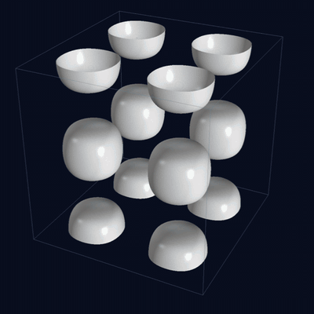
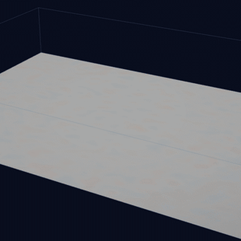
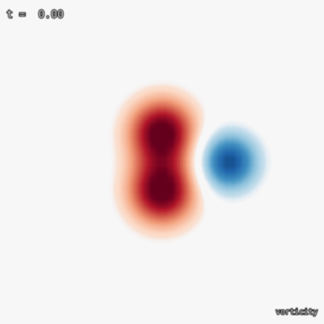
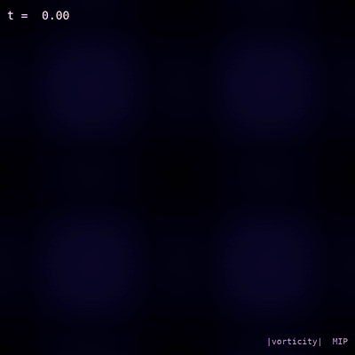

I work on high-order PDE discretizations for CFD and thermal-fluid problems: structure-preserving operators, sparse iterative and direct solvers, matrix-free methods, and GPU kernels in C++, Python and CUDA. PhD in Computational Aerospace Engineering (UIUC, 2019), five years in an NNSA exascale simulation center, then six years leading applied ML in industry. Director of Data Science and ML at NBCUniversal; 4 granted US patents and 4 patents pending.

### Research

- **GPU-native sparse solvers.** Krylov solvers co-designed with the discretization: polynomial-preserving aggregation keeps cut-cell conditioning within 3.7x (vs 1.8e11), so preconditioned CG converges in every stress case. 14 CUDA kernels.
- **Structure-preserving discretizations.** Summation-by-parts operators on B-spline finite element spaces; mass, momentum and energy conserved to round-off; provably energy-stable wall closures.
- **Matrix-free methods.** Batched 1D line kernels instead of assembled 3D operators: 16.8M unknowns in 1.98 s with 6.14 KB of operator data.
- **Scientific ML.** Conditioning of PINNs and DeepONets, automated solver control, hybrid analytic and ML models, automated algorithm selection.

### Selected projects

<table>
<tr>
<td width="50%" valign="top">
 
<a href="https://github.com/bay-yearick-lab/gpu-cutcell-navier-stokes"><b>gpu-cutcell-navier-stokes</b></a> 
Solves the small-cell problem in cut-cell CFD: preconditioned Krylov solvers converge in every sliver stress case on GPU; skew-symmetric compressible solver (Taylor-Green vortex, 96&sup3;).
</td>
<td width="50%" valign="top">
 
<a href="https://github.com/bay-yearick-lab/high-order-turbulence-dns"><b>high-order-turbulence-dns</b></a> 
High-order B-spline DNS of compressible turbulence (M = 1.5) with provably stable, boundary-consistent stabilization and automated per-step solver control (JCP 2020).
</td>
</tr>
<tr>
<td width="50%" valign="top">
 
<a href="https://github.com/bay-yearick-lab/energy-stable-sbp-closures"><b>energy-stable-sbp-closures</b></a> 
Provably energy-stable high-order wall closures with inf-sup-stable pressure; 1.6&times;105 lower error than the strongest published stable closure.
</td>
<td width="50%" valign="top">
 
<a href="https://github.com/bay-yearick-lab/high-order-periodic-bspline"><b>high-order-periodic-bspline</b></a> 
High-order periodic B-spline operators with spectral-like resolution: up to 43x more accurate than the spectral-like compact scheme, conservation to round-off.
</td>
</tr>
</table>

Also: **[pinn-boundary-conditioning](https://github.com/bay-yearick-lab/pinn-boundary-conditioning)** (conditioning laws for PINNs and DeepONets; hard constraints 9x more accurate, theory within 0.36%), [no-3d-matrices](https://github.com/bay-yearick-lab/no-3d-matrices) (matrix-free batched line solvers), [petsc-bspline-compressible](https://github.com/bay-yearick-lab/petsc-bspline-compressible) (parallel PETSc, GMRES/CG, MPI), [energy-conserving-cutcell](https://github.com/bay-yearick-lab/energy-conserving-cutcell), [sharp-immersed-boundary-projection](https://github.com/bay-yearick-lab/sharp-immersed-boundary-projection), [sbp-closure-optimizer](https://github.com/bay-yearick-lab/sbp-closure-optimizer).

### Publications and software

- Y. Y. Bay et al. Boundary consistent B-spline filtering schemes and application to high fidelity simulations of turbulence. *Journal of Computational Physics* 419 (2020). [doi:10.1016/j.jcp.2020.109680](https://doi.org/10.1016/j.jcp.2020.109680) · [code](https://github.com/bay-yearick-lab/high-order-turbulence-dns)
- Y. Y. Bay, K. A. Yearick. No 3D Matrices: a unified tensor-product view of matrix-free Cartesian PDE solvers. [arXiv:2606.25148](https://arxiv.org/abs/2606.25148) (2026) · [code](https://github.com/bay-yearick-lab/no-3d-matrices)
- Y. Y. Bay, K. A. Yearick. Structure-preserving B-spline cut-cell flow solvers on the GPU. In preparation · [code](https://github.com/bay-yearick-lab/gpu-cutcell-navier-stokes)
- Y. Y. Bay, K. A. Yearick. Energy-stable summation-by-parts closures for clamped B-splines. In preparation · [code](https://github.com/bay-yearick-lab/energy-stable-sbp-closures)
- Y. Y. Bay, K. A. Yearick. Soft boundary conditions in physics-informed neural networks and DeepONets: a penalty-method analysis. In preparation · [code](https://github.com/bay-yearick-lab/pinn-boundary-conditioning)
- Y. Y. Bay, K. A. Yearick. High-order periodic exponential B-spline operators. In preparation · [code](https://github.com/bay-yearick-lab/high-order-periodic-bspline)
- Y. Y. Bay. Energy-conserving cut-cell method for the incompressible Navier-Stokes equations. In preparation · [code](https://github.com/bay-yearick-lab/energy-conserving-cutcell)
- Y. Y. Bay, K. A. Yearick. Solve for the hyperparameter, skip the search: Kolmogorov-optimal scaling laws for spline regression. [arXiv:2606.23575](https://arxiv.org/abs/2606.23575) (2026) · [code](https://github.com/bay-yearick-lab/kore)
- Y. Y. Bay, K. A. Yearick. Machine learning vs deep learning: the generalization problem. [arXiv:2403.01621](https://arxiv.org/abs/2403.01621) (2024)

Also: [parallel PETSc Galerkin solver](https://github.com/bay-yearick-lab/petsc-bspline-compressible), [sharp immersed boundary projection](https://github.com/bay-yearick-lab/sharp-immersed-boundary-projection), [SBP closure optimizer](https://github.com/bay-yearick-lab/sbp-closure-optimizer). Full list on [ORCID](https://orcid.org/0009-0006-6464-5344).

### Patents

Machine learning that makes solver-style decisions: selecting the right algorithm for each problem, hybrid analytic and ML models, learning from sparse data, and measuring the failure rate and correctness of deployed models. 4 granted, 4 pending.

- **Solver-control policy: picks the right algorithm per problem, failure rate 23% → 5%.** Dynamic model selection for accurate time series forecasting, [US 2025/0104103](https://patents.google.com/patent/US20250104103A1/en) (pending). Data diagnostics route each problem to an analytic solver or a gradient-boosted model; failure rate cut from 23% to 5%.
- **Learning across related problems: 1 day of data matches 90-day accuracy.** Glass-box transfer learning algorithm for accurate forecasting, [US 2025/0390800](https://patents.google.com/patent/US20250390800A1/en) (pending). Interpretable transfer from data-rich archetypes to cold-start problems.
- **Hybrid numerical/ML algorithm: closed-form solutions train the ML model.** Genre-adaptive analytic exponential modeling for accurate forecasting, [US 2025/0390898](https://patents.google.com/patent/US20250390898A1/en) (pending). Closed-form analytic solutions generate training data for ML learners.
- **Failure-rate evaluation: statistical tests separate real failures from noise.** Bias detection in speech recognition models, [US 11,626,112](https://patents.google.com/patent/US11626112B1/en) and [US 11,817,098](https://patents.google.com/patent/US11817098B1/en) (granted). Statistical and practical significance tests that separate real failures from noise.
- **Correctness evaluation: calibrated pass/fail thresholds from limited labels.** KPI-threshold selection and categorizing audio transcriptions, [US 11,922,943](https://patents.google.com/patent/US11922943B1/en) and [US 12,308,030](https://patents.google.com/patent/US12308030B2/en) (granted), [US 2025/0273215](https://patents.google.com/patent/US20250273215A1/en) (pending). Calibrated thresholds learned from limited expert labels.

### Contact

[LinkedIn](https://www.linkedin.com/in/yong-yi-bay) · yongyibay@gmail.com
