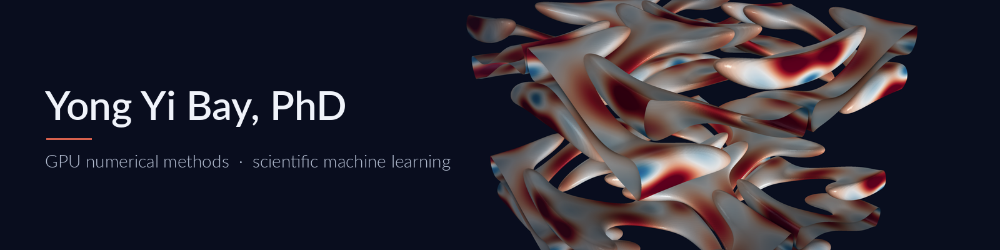
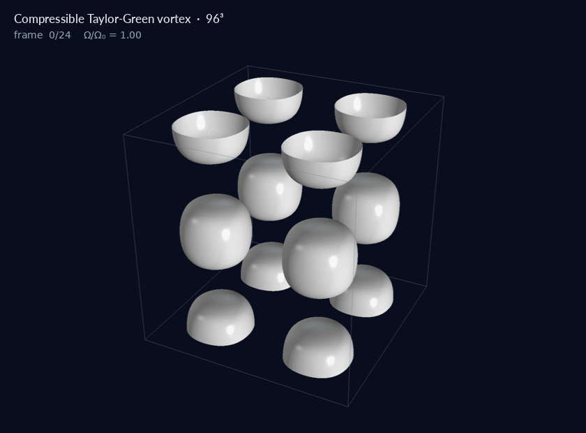

I work on high-order PDE discretizations for CFD and thermal-fluid problems: structure-preserving operators, sparse iterative and direct solvers, matrix-free methods, and GPU kernels in C++, Python and CUDA. PhD in Computational Aerospace Engineering (UIUC, 2019), five years in an NNSA exascale simulation center, then six years leading applied ML in industry. Director of Data Science and ML at NBCUniversal; 4 granted US patents and 4 patents pending.

### Research

- **GPU-native sparse solvers.** Preconditioned Krylov solvers co-designed with the discretization so they do not fail on cut cells: polynomial-preserving aggregation holds conditioning within 3.7x per degree across 72 cut geometries (1.8e11 without it), and Jacobi-preconditioned CG converges in every stress case, down to cells 1/100,000 the size of a full cell. 14 CUDA kernels (cuBLAS strided-batched solves, cuFFT projection, CSR gather/scatter) for a device-resident periodic-hill time step.
- **Structure-preserving discretizations.** Summation-by-parts operators on isogeometric finite element (B-spline Galerkin) spaces for cut-cell and wall-bounded domains. Mass, momentum and total-energy budgets close at round-off (6.1e-15 or below); wall closures are provably energy-stable with an inf-sup-stable pressure.
- **Matrix-free methods.** 256&sup3; (16.8M unknowns) in 1.98 s on CPU with 6.14 KB of operator data; batched 1D line kernels instead of an assembled 3D operator. Pencil-preconditioned, matrix-free LOBPCG for inf-sup eigenvalues on Kronecker-sum operators up to 513 basis functions per direction.
- **Scientific ML.** ([pinn-boundary-conditioning](https://github.com/bay-yearick-lab/pinn-boundary-conditioning)) Conditioning of physics-informed neural networks and DeepONets, data-driven solver control by parameter selection, hybrid analytic and ML models, and patented methods for automated algorithm selection and learning from sparse data.

### Selected projects

<table>
<tr>
<td width="50%" valign="top">
 
<a href="https://github.com/bay-yearick-lab/gpu-cutcell-navier-stokes"><b>gpu-cutcell-navier-stokes</b></a> 
High-order B-spline cut-cell CFD that solves the small-cell problem. Jacobi-preconditioned CG converges in 25 of 25 sliver stress cases, with GPU sparse PCG and CUDA kernels on cuBLAS and cuFFT.
</td>
<td width="50%" valign="top">
 
<a href="https://github.com/bay-yearick-lab/energy-stable-sbp-closures"><b>energy-stable-sbp-closures</b></a> 
Provably energy-stable B-spline summation-by-parts wall closures. After six wall transits of closed-box acoustics: 1.6&times;105 lower error than the strongest stable published closure.
</td>
</tr>
<tr>
<td width="50%" valign="top">
 
<a href="https://github.com/bay-yearick-lab/no-3d-matrices"><b>no-3d-matrices</b></a> 
Finite difference, compact, Galerkin/IGA, ADI and fast Poisson solvers as batched 1D banded kernels: 256&sup3; (16.8M unknowns) in 1.98 s on CPU with 6.14 KB of operator data. <a href="https://arxiv.org/abs/2606.25148">arXiv:2606.25148</a>
</td>
<td width="50%" valign="top">
 
<b>Compressible Taylor-Green vortex, 96&sup3;</b> 
Skew-symmetric compressible solver: vortex tubes stretch into sheets and roll up. Isosurfaces of vorticity magnitude, coloured by dilatation.
</td>
</tr>
</table>

### Publications

- Y. Y. Bay et al. Boundary consistent B-spline filtering schemes and application to high fidelity simulations of turbulence. *Journal of Computational Physics* 419 (2020). [doi:10.1016/j.jcp.2020.109680](https://doi.org/10.1016/j.jcp.2020.109680)
- Y. Y. Bay, K. A. Yearick. No 3D Matrices: a unified tensor-product view of matrix-free Cartesian PDE solvers. [arXiv:2606.25148](https://arxiv.org/abs/2606.25148) (2026)
- Y. Y. Bay, K. A. Yearick. Solve for the hyperparameter, skip the search: Kolmogorov-optimal scaling laws for spline regression. [arXiv:2606.23575](https://arxiv.org/abs/2606.23575) (2026)
- Y. Y. Bay, K. A. Yearick. Machine learning vs deep learning: the generalization problem. [arXiv:2403.01621](https://arxiv.org/abs/2403.01621) (2024)

Full list on [ORCID](https://orcid.org/0009-0006-6464-5344).

### Patents

Automated algorithm selection, hybrid analytic and ML models, transfer learning for data-sparse problems, and statistical evaluation of deployed models. Granted: [US 11,626,112](https://patents.google.com/patent/US11626112B1/en), [US 11,817,098](https://patents.google.com/patent/US11817098B1/en), [US 11,922,943](https://patents.google.com/patent/US11922943B1/en), [US 12,308,030](https://patents.google.com/patent/US12308030B2/en). Pending: [US 2025/0104103](https://patents.google.com/patent/US20250104103A1/en), [US 2025/0390800](https://patents.google.com/patent/US20250390800A1/en), [US 2025/0390898](https://patents.google.com/patent/US20250390898A1/en), [US 2025/0273215](https://patents.google.com/patent/US20250273215A1/en).

### Contact

[LinkedIn](https://www.linkedin.com/in/yong-yi-bay) · yongyibay@gmail.com
